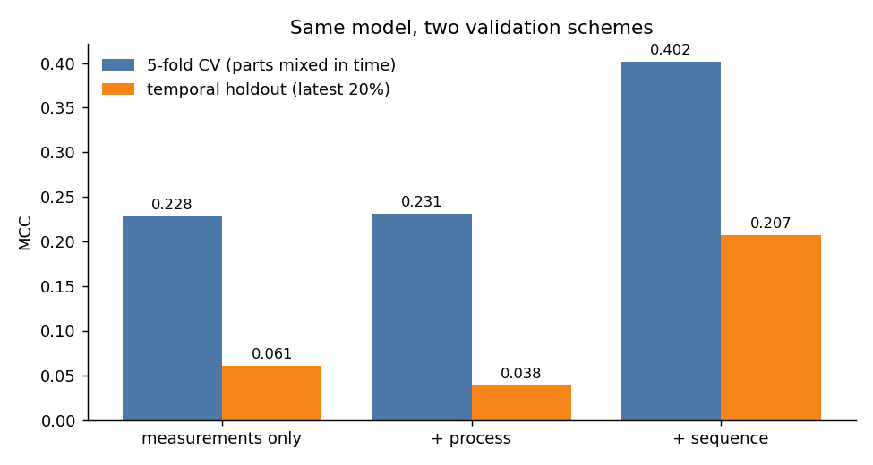
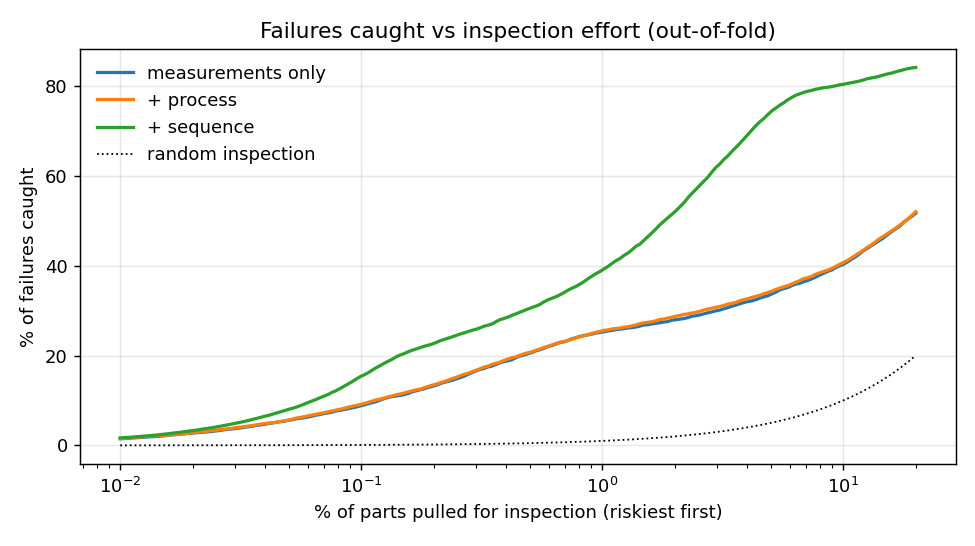

[English ] | [[Español](README.es.md) ]

# Bosch production line: which parts will fail quality control?


1.18 million real parts from a Bosch assembly line, each with up to 4,264 anonymous
measurements and timestamps across 52 stations, and 0.58% of them failing final quality
control. Data from the Kaggle competition
[Bosch Production Line Performance](https://www.kaggle.com/competitions/bosch-production-line-performance).

The question I care about is the one a quality engineer would ask: **if we can only inspect a
few percent of the parts, which ones, and what does it save?**

**Kaggle late submission:** MCC **0.400** public / **0.418** private (competition metric;
the winning solution scored about 0.52).

## Results

LightGBM on three feature sets, each scored two ways: stratified 5-fold CV over all parts, and
a temporal holdout (fit on the earliest 80% of parts by start time, score the latest 20%).

| Features | CV MCC | Temporal holdout MCC |
|---|---|---|
| 968 measurements | 0.228 | 0.061 |
| + process (route, stations, time per line) | 0.231 | 0.038 |
| + sequence (position in the production flow) | **0.402** | **0.207** |



**1. Failures come in lots, not in parts.** When the part produced next to a failed part also
fails, it is no coincidence: the failure rate among time-neighbours of a failure is 6.4%,
11 times the base rate. The two most important features by far are `id_gap_next` and
`same_lot_next`: whether the next part has a consecutive Id and the same start time, i.e. where
the part sits inside its lot. The measurements matter much less; only a handful from stations
S29, S24 and S33 show up in the top features.

**2. Cross-validation overstates what the model can do on future parts.** Shuffled CV mixes
parts from the whole period, so the model learns period-specific patterns and is scored on
the same periods. On parts produced later, the measurement-only model drops from 0.228 to 0.061.
The sequence features are the only ones that hold up (0.207), and their decision threshold,
picked on the earlier period, is still near-optimal on the later one (0.207 vs an oracle 0.208);
the other feature sets lose the threshold as well as the ranking.

**3. Process features add nothing on their own.** Route, station counts and dwell times barely
move CV (+0.003) and make the temporal score worse.

The Kaggle test set interleaves with the training parts in time, which is why the leaderboard
(0.418) tracks CV (0.402) rather than the temporal holdout. A model deployed on the line would
see the temporal number.

## From MCC to an inspection policy

Rank parts by predicted risk and pull the riskiest for manual inspection:

| Parts inspected | Failures caught (CV) | Failures caught (later parts) |
|---|---|---|
| 1% | 39% | 22% |
| 2% | 52% | 32% |
| 5% | 74% | 61% |
| 10% | 80% | 77% |



With a cost per inspection of 1 and a cost per escaped failure of R, the policy that minimises
total cost inspects the top-k parts. If an escaped failure costs 100 times an inspection, the
best policy on later parts inspects 6.6% of production and cuts the cost of quality to **40%**
of inspecting nothing (33% by CV). The full table for R from 10 to 1,000 is in
[`reports/inspection.json`](reports/inspection.json).

## Method

```
train/test CSVs (14 GB) ──► Parquet with explicit schema (2.3 GB, 5 min)
        │
        ├── numeric: 968 measurements as-is
        ├── process: station visits, time per line, measurement count, route frequency
        └── sequence: sort by (start time, Id) over train+test; Id gap and time gap to
                      neighbours, lot size and position, same-lot flags
                      (timestamps and Ids only; no neighbour labels, so no leakage)
        │
LightGBM (early stopping on an inner 10% split, never on the scored fold)
        │
threshold maximising out-of-fold MCC ──► submission.csv (3-seed average)
        │
capture curve and cost-optimal inspection policy
```

## Data

[Bosch Production Line Performance](https://www.kaggle.com/competitions/bosch-production-line-performance),
Kaggle, 2016. Downloaded October 2026 under the competition rules, which do not allow
redistribution; the data is not in this repository.

## Reproduce

```powershell
python -m venv venv
.\venv\Scripts\python.exe -m pip install -r requirements.txt
$env:PYTHONPATH = "src"
python -m bosch.ingest      # needs ~/.kaggle/kaggle.json and accepted competition rules
python -m bosch.features
python -m bosch.model       # three feature sets, CV + temporal holdout (~15 min)
python -m bosch.submit      # final model and submission.csv
python -m bosch.analysis    # inspection policy, figures
pytest -q tests
```

## Limitations

- Features are anonymous, so the measurement findings cannot be traced to physical quantities.
- One model family and one set of hyperparameters; no tuning beyond early stopping.
- The cost model assumes inspection catches every failure it looks at, and a flat cost per
  escaped failure.

## License

Code: MIT. Data: Kaggle competition rules (not redistributed).
